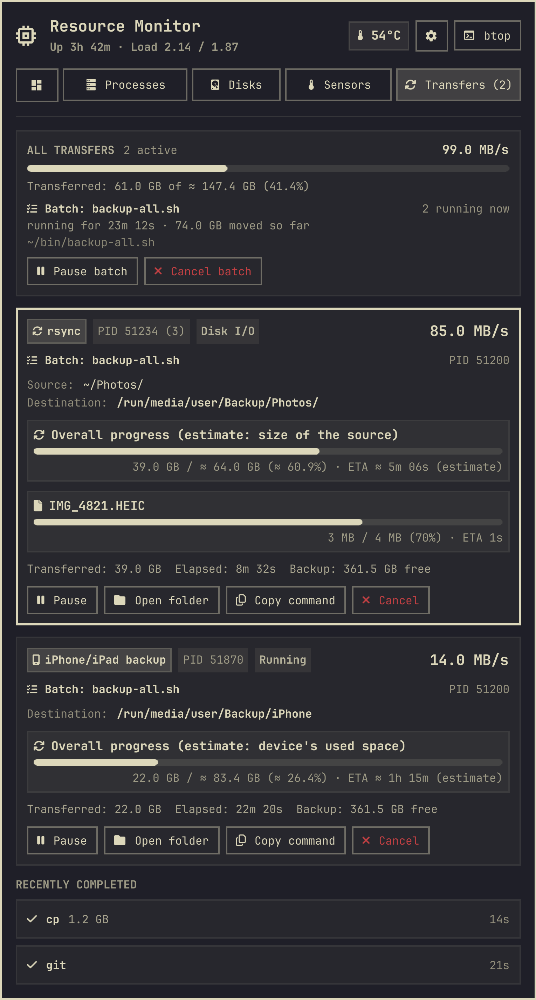
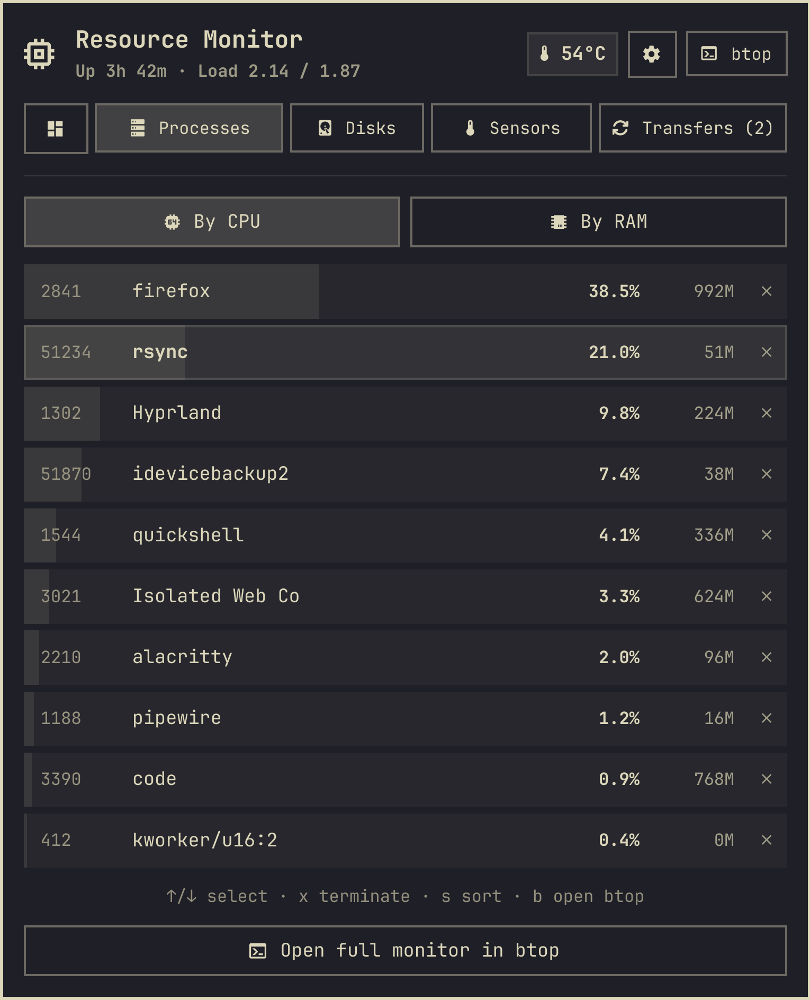
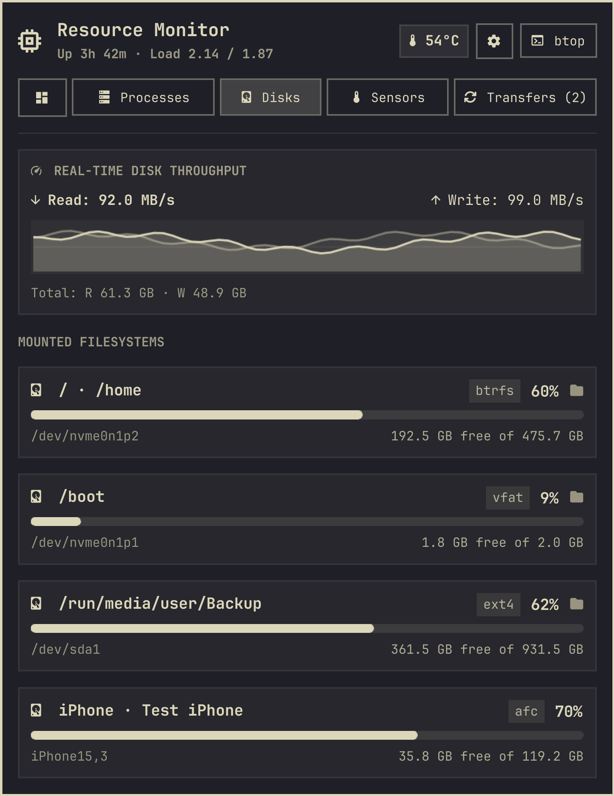
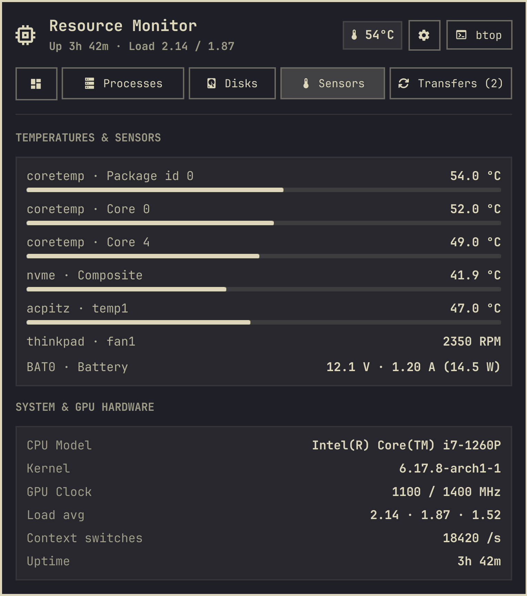
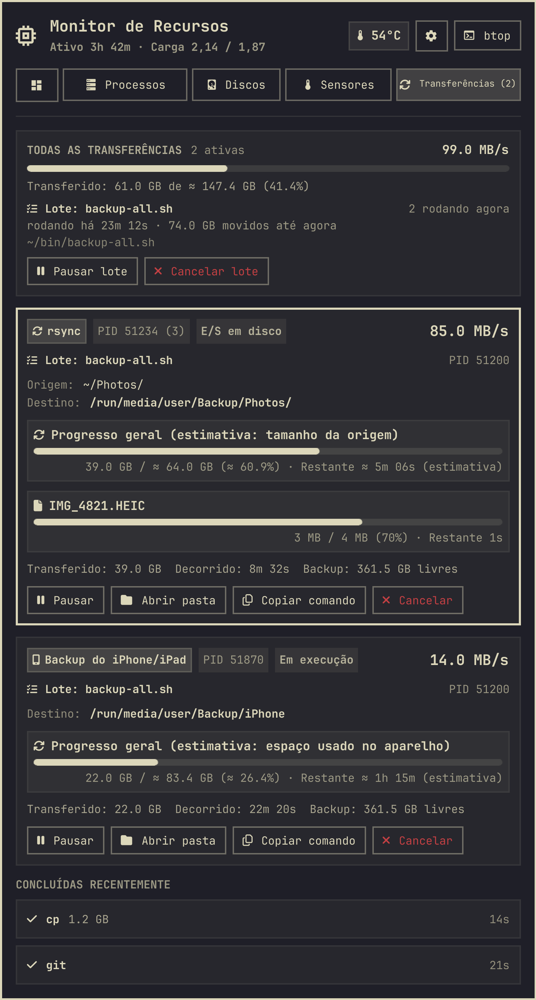

# Resource Monitor for Omarchy

A system monitor for the [Omarchy](https://omarchy.org) bar: live CPU, memory, network
and disk I/O, a process list you can act on, disks (connected iPhones and iPads included),
temperature sensors, and the file transfers running in the background (`rsync`, `cp`,
downloads, iPhone/iPad backups and more) with speed, progress and ETA.

<p align="center"></p>

## What you get

- **Bar label** with CPU and RAM, in four modes: compact, detailed (adds temperature and
  memory used), full (adds network speed) or icon only. Right-click the label to cycle them.
- **Overview**: CPU (history graph, per-core load and frequency), memory and swap,
  network and disk I/O graphs, and a Transfers card. Click the card to open the Transfers tab.
- **Processes**: the top 10 by CPU or by memory. Terminate one (SIGTERM) with a click or
  <kbd>x</kbd>, or open `btop`.
- **Disks**: every mounted filesystem with free space. Click a disk to open it in your
  file manager (`xdg-open`). Connected **iPhones and iPads** are listed with their storage
  when `libimobiledevice` is installed (they have no folder to open).
- **Sensors**: temperatures, fans, battery power, CPU model, kernel, GPU clock, load,
  context switches and uptime.
- **Transfers**: `rsync`, `rclone`, `cp`, `mv`, `dd`, `pv`, `curl`, `wget`, `aria2c`,
  `yt-dlp`, `git`, `idevicebackup2`, `restic`, `borg`, `btrfs`, `pacman`/`yay`/`paru`,
  `tar`, `zstd` and `ffmpeg` started by you. Each shows speed, the file being copied,
  overall progress and ETA when the total size is known, and can be paused, resumed,
  cancelled, opened or copied as a command. A notification tells you when a long transfer
  finishes. Paths are shown in full (relative ones resolved against the command's working
  directory), a folder's total size is worked out in the background with `du`, and a card
  at the top adds everything up. A transfer started by a script (`bash backup.sh`, a
  Python script, `make`) is shown as a step of that **batch**, with the script's path, how
  long it has been running and how much it has moved so far; **Pause batch** and **Cancel
  batch** act on the whole script (cancelling one transfer only ends that step, and the
  script moves on to the next).
- **iPhone/iPad backups** (`idevicebackup2 backup`): the backup size is not known up front,
  so progress and ETA are estimated from the space used on the device and marked with
  **≈** and *(estimate)*.
- Follows the Omarchy theme live, and speaks English and Portuguese (Brazil and Portugal).

<p align="center">
  
  
  
</p>
<p align="center">
  
  
</p>

*(Screenshots are rendered from mock data by the dev harness, see [Development](#development).)*

## Install

```bash
omarchy plugin add https://github.com/gusthanks/omarchy-resources.git --enable
omarchy restart shell
```

Update with `omarchy plugin update gusthx.resources --yes`, then `omarchy restart shell`.

### Requirements

Required: `python3` (transfers) and `procps` (`ps`), both on every Omarchy install.
Optional, each one adds a feature:

| Package | Adds |
|---|---|
| `libimobiledevice` | iPhone/iPad storage on the Disks tab, size estimate for `idevicebackup2` backups |
| `btop` | the *btop* button and <kbd>b</kbd> |
| `lm_sensors` / hwmon drivers | more entries on the Sensors tab |
| `xdg-utils` and a file manager | opening disks and transfer folders |
| `wl-clipboard` | *Copy command* |
| `libnotify` (`notify-send`) | the "transfer finished" notification |

## Use

| On the bar label | Does |
|---|---|
| Left click | Open or close the popup |
| Middle click | Open `btop` |
| Right click | Next bar mode (compact, detailed, full, icon) |

In the popup:

| Key | Does |
|:---:|:---|
| <kbd>1</kbd>–<kbd>5</kbd>, <kbd>←</kbd>/<kbd>→</kbd> | Switch tab (Overview, Processes, Disks, Sensors, Transfers) |
| <kbd>↑</kbd>/<kbd>↓</kbd> | Select a process or transfer; scroll on the other tabs |
| <kbd>PgUp</kbd>/<kbd>PgDn</kbd>, <kbd>Home</kbd>/<kbd>End</kbd> | Scroll the tab |
| <kbd>s</kbd> | Sort processes by CPU or memory |
| <kbd>x</kbd> / <kbd>Delete</kbd> | Terminate the selected process, or cancel the selected transfer |
| <kbd>p</kbd> | Pause or resume the selected transfer |
| <kbd>o</kbd> | Open the selected transfer's destination |
| <kbd>c</kbd> | Copy the selected transfer's command |
| <kbd>b</kbd> | Open `btop` |
| <kbd>m</kbd> | Next bar mode |
| <kbd>r</kbd> | Refresh now |
| <kbd>Esc</kbd> | Close |

From a keybinding or script:

```bash
omarchy-shell gusthx.resources toggle   # also: open, close, cycleMode
```

The bar mode is saved on the widget's entry in `~/.config/omarchy/shell.json`
(`"barMode": "compact" | "detailed" | "full" | "icon"`).

## Privacy

Nothing leaves your machine: no network requests, no telemetry, no logs.

What it **reads**: `/proc` (CPU, memory, network and disk counters; for your own processes
also their command lines, open files under `/proc/<pid>/fd` and I/O counters, to detect
transfers and the file being copied), `/sys` (temperatures, frequencies, fans, battery),
`df` and `ps` output, and, when `libimobiledevice` is installed, the name, model and storage
of connected iPhones/iPads (`idevice_id`, `ideviceinfo`).

What it **writes**, only in your per-user runtime directory (`$XDG_RUNTIME_DIR`, normally
`/run/user/<uid>`, readable only by you, cleared at logout):

- `gusthx-resources-transfers.json`: the transfers seen in the last run (commands, paths,
  byte counters) and the last few finished ones, to compute speeds.
- `gusthx-resources-size-<pid>-<start>`: the size `du` found for the folders a running
  transfer reads; removed when the transfer ends.
- `gusthx-resources-ios.tsv`: connected iPhones/iPads (name, model, storage, UDID), cached
  for 30 seconds.

What it **does** only when you ask: sends SIGTERM to a process, SIGSTOP/SIGCONT/SIGTERM to
a transfer, opens folders with `xdg-open`, copies a command to the clipboard (`wl-copy`),
opens `btop`. When a long transfer finishes it shows a desktop notification.

## Development

Work in a clone of this repository, never in the installed copy under
`~/.config/omarchy/plugins/` (saving there hot-reloads your bar). `dev/run.sh` starts a
**separate** Quickshell instance with Omarchy's `Commons`/`Ui` libraries, this repo and
mock data from `dev/mock/`: it never reads your system, runs the collectors or touches the
running shell. Captures render offscreen, so nothing shows on screen.

```bash
dev/run.sh check     # compile every QML type, Panel.qml included
dev/run.sh test      # Model.js, i18n and collector tests (node --test + python3 unittest, no packages)
dev/run.sh docs      # docs/overview.png, processes.png, disks.png, sensors.png, transfers.png, preview.png
dev/run.sh preview   # the popup in a window, with mock data
LANGUAGE=pt-BR dev/run.sh transfers   # docs/transfers-pt-BR.png
omarchy plugin validate .   # from a clean checkout (a local node_modules/ makes it fail)
```

Layout: `Panel.qml` (bar label, popup window, IPC), `Monitor.qml` (sampling, collectors and
actions), `ResourcesView.qml` (the popup's content, fed by `Monitor.qml` or by the harness),
`Model.js` (pure parsing and formatting), `collect-details.sh` (CPU, sensors, disks,
iPhones/iPads, top processes), `collect-transfers.py` (transfer detection and actions),
`i18n/*.json` (strings, read through `Commons.Translations`), `dev/` (harness, mocks,
tests, deploy).

When everything is committed and tested, install it into your own bar once:

```bash
dev/deploy.sh   # validates, compiles, installs HEAD into the live plugin, restarts the shell once
```

If the live folder is a plain copy rather than a git checkout, `deploy.sh` first moves it to
`~/Work/backups/gusthx.resources.<timestamp>` and replaces it with a checkout of this repo.
[AGENTS.md](AGENTS.md) and `CLAUDE.md` hold the rules AI agents (and humans) follow here.

## License

[MIT](LICENSE) © gusthx
