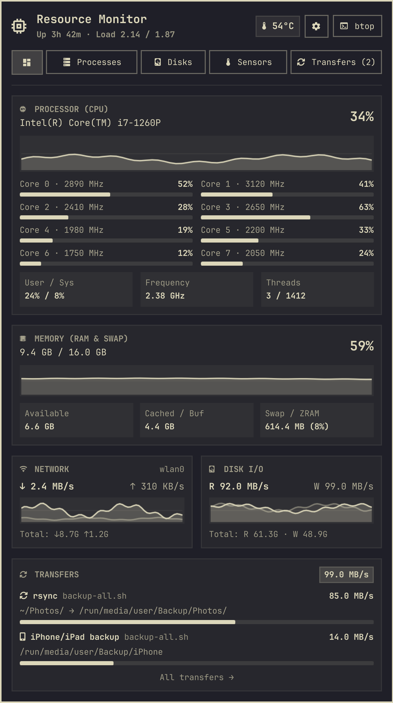

# 🚀 omarchy-transfers

> **Transfer Monitor** — Elegant, non-intrusive background file transfer monitor for the [Omarchy](https://omarchy.org) status bar.

[](https://omarchy.org)
[](manifest.json)
[](LICENSE)
[](https://wiki.hypr.land)

`omarchy-transfers` seamlessly tracks active CLI and background file transfers (`rsync`, `rclone`, `dd`, `git clone`, `curl`, `wget`, `cp`, `tar`) directly from your top bar.

No need to open multiple terminals or write custom monitoring scripts: when any transfer begins anywhere on your system, the widget automatically wakes up, displays live speeds on your bar, and gives you rich progress inspection and process controls in one click.

---

## ✨ Features

- **👻 Ghost State (Zero Visual Clutter):** Auto-collapses from the bar when no transfers are active. It only shows up when work is actually being done. *(Configurable to always stay visible in Settings)*.
- **🔍 Deep Kernel Telemetry via `/proc/`:** Unlike generic desktop widgets, `omarchy-transfers` inspects `/proc/<pid>/fd/` and `/proc/<pid>/io` in real time to show:
  - Exact file currently being written/read (with individual percentage and ETA).
  - Overall job progress and volume transferred.
  - Aggregated read/write throughput in MB/s.
  - Free space on destination filesystem to prevent accidental disk full errors.
- **⚡ Broad Tool Support:** Out-of-the-box detection for:
  - `rsync` (Local & remote synchronizations)
  - `rclone` (Cloud storage sync: Google Drive, S3, Nextcloud, OneDrive)
  - `dd` (ISO disk imaging & drive flashing)
  - `git clone` (Large repository downloads)
  - `curl` / `wget` (CLI downloads)
  - `cp` / `mv` / `tar` (Heavy local I/O)
- **⏯️ Process Controls:** Pause (`SIGSTOP`), Resume (`SIGCONT`), or Cancel (`SIGTERM`) any active transfer with a single click.
- **📂 Quick Actions:** Open the destination directory directly in your file manager (*Nautilus/Files*) or copy the full executed command to clipboard.
- **🎨 100% Native Omarchy Theming:** Fully integrated with Quickshell, respecting Omarchy's design tokens, dynamic color schemes, typography, borders, and corner radii.
- **⌨️ Keyboard Navigation:** Full keyboard shortcut support when the panel is open (`p` to pause/resume, `o` to open folder, `c` to copy command, `r` to refresh, `1/2/3` to switch tabs).

---

## 📸 Preview



*Live card showing real-time disk I/O, individual file progress (`DJI_0805.MP4`), overall progress bar, free space, and interactive action buttons.*

---

## 📦 Installation

Install directly using the Omarchy CLI:

```bash
omarchy plugin add https://github.com/gusthx/omarchy-transfers --enable
```

To reload the shell immediately:

```bash
omarchy restart shell
```

---

## 🛠️ Usage & Keyboard Shortcuts

When transfers are active, click on the **Transfer Monitor** icon in your status bar or press `SUPER + CTRL + W` (if bound) to toggle the popover.

| Key | Action |
|:---:|:---|
| `1` | Switch to **Active Transfers** tab |
| `2` | Switch to **Recent Completed** tab |
| `3` | Switch to **Settings** tab |
| `p` / `P` | Pause or Resume the selected transfer |
| `o` / `O` | Open destination folder in file manager |
| `c` / `C` | Copy executed command to clipboard |
| `r` / `R` | Force immediate refresh of transfer telemetry |
| `Esc` | Close panel |

---

## 🏗️ Architecture

```
┌────────────────────────────────────────┐
│          Linux Kernel /proc            │
│  /proc/<pid>/io   /proc/<pid>/fd/      │
└───────────────────┬────────────────────┘
                    │
                    ▼
┌────────────────────────────────────────┐
│     collect-transfers.py (Engine)      │
│  • Process tree inspection             │
│  • Exponential Moving Average (Speed)  │
│  • Active file descriptor tracking     │
└───────────────────┬────────────────────┘
                    │ JSON stdout
                    ▼
┌────────────────────────────────────────┐
│       Panel.qml (Quickshell UI)        │
│  • Reactive bar widget                 │
│  • Omarchy BorderSurface & Theme       │
│  • KeyboardPanel + Flickable layout    │
└────────────────────────────────────────┘
```

---

## 🤝 Contributing

Contributions, bug reports, and suggestions are welcome!

1. Fork the Project
2. Create your Feature Branch (`git checkout -b feature/AmazingFeature`)
3. Commit your Changes (`git commit -m 'Add some AmazingFeature'`)
4. Push to the Branch (`git push origin feature/AmazingFeature`)
5. Open a Pull Request

---

## 📄 License

Distributed under the MIT License. See [`LICENSE`](LICENSE) for more information.

Developed with ❤️ by [Gustavo Costa (@gusthx)](https://github.com/gusthx) for the Omarchy community.
