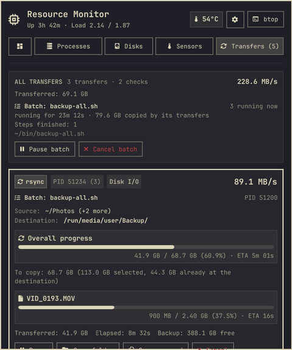
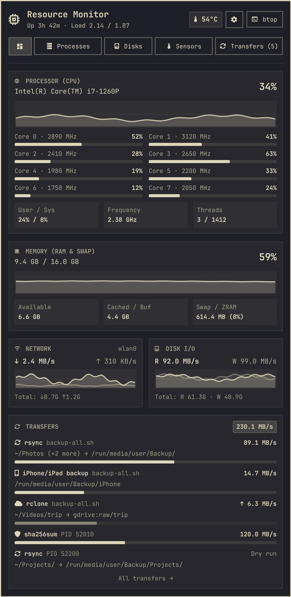
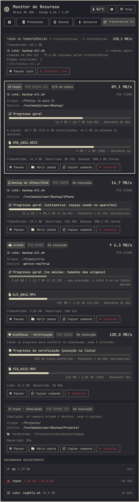
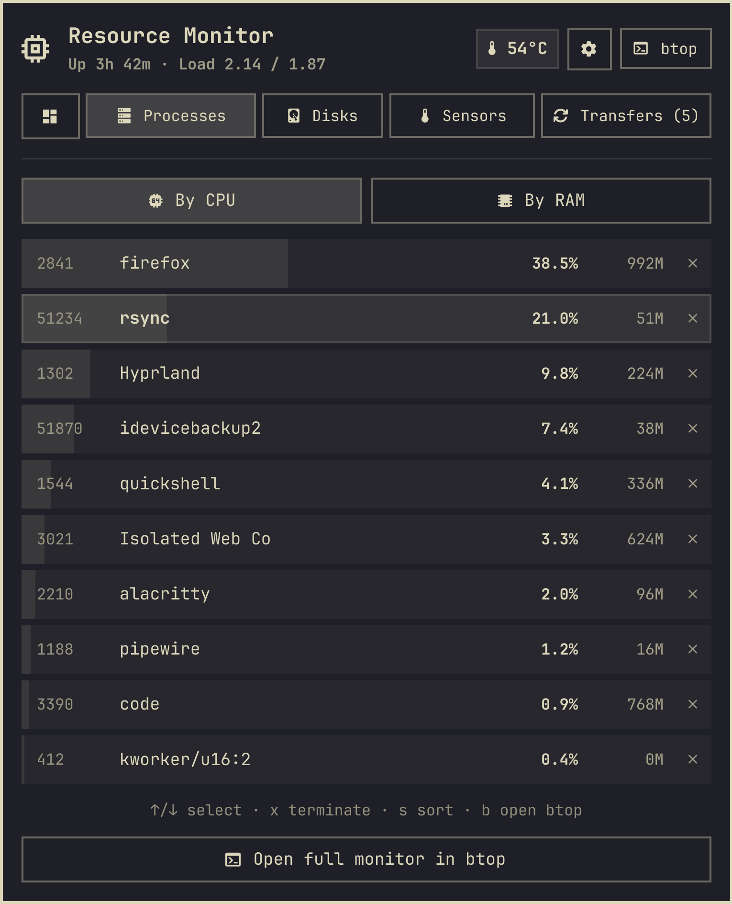
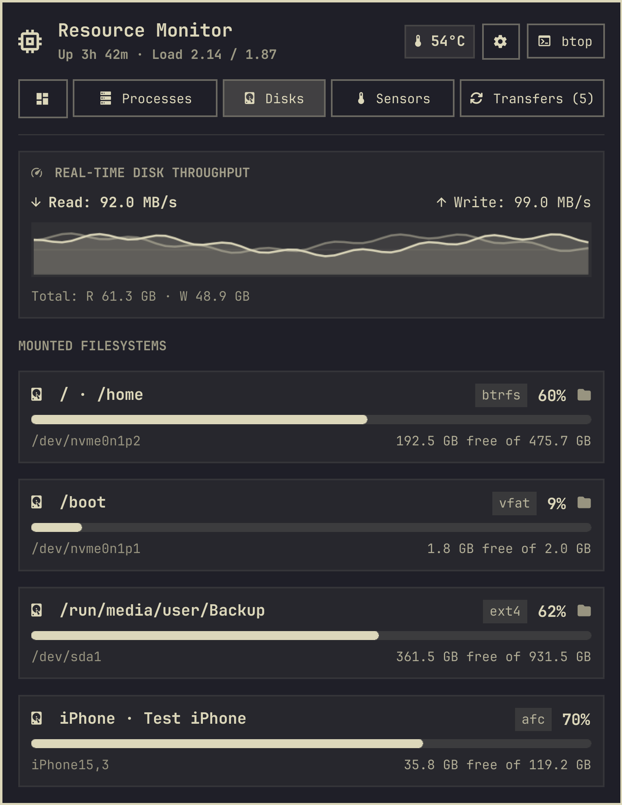
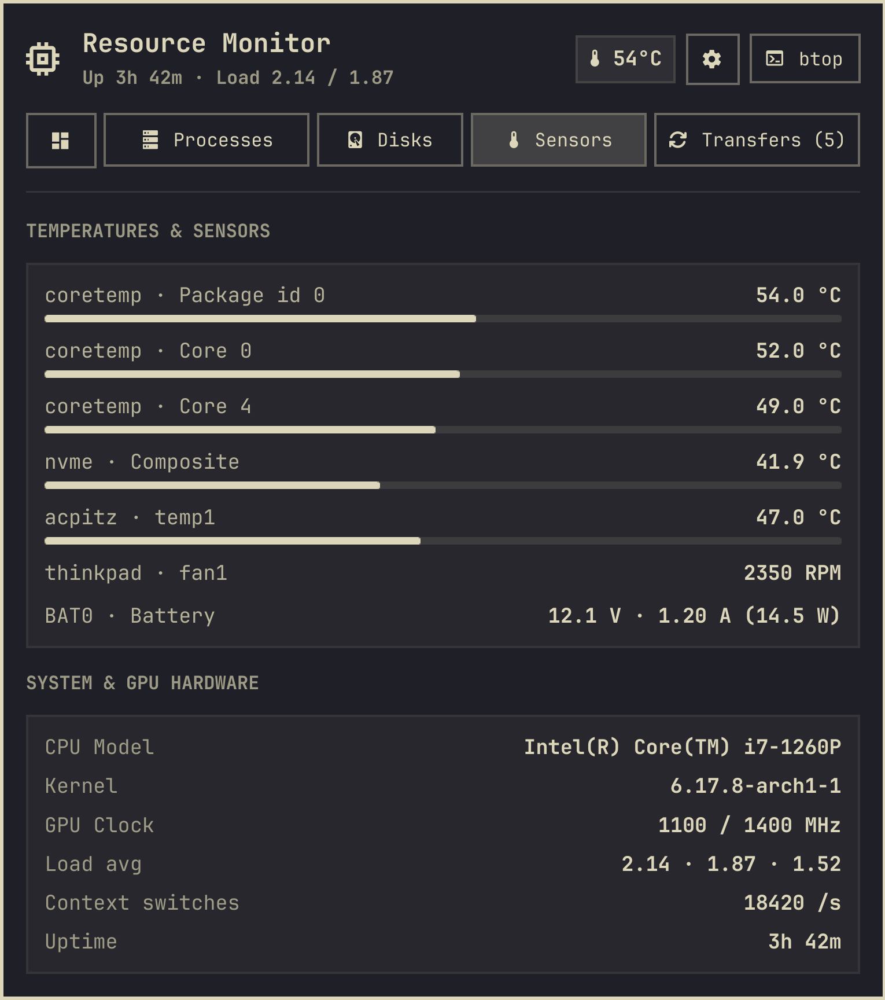

# Resource Monitor para Omarchy

Um monitor do sistema para a barra do [Omarchy](https://omarchy.org): CPU, memória, rede e
E/S de disco ao vivo, uma lista de processos em que você pode agir, discos (iPhones e iPads
conectados inclusive), sensores de temperatura e as transferências de arquivos rodando em
segundo plano (`rsync`, `cp`, downloads, uploads para um remoto na nuvem, backups de
iPhone/iPad e mais) com velocidade, progresso e tempo restante.

🇺🇸 [Read in English](README.md)

<p align="center"></p>

## O que você ganha

- **Rótulo na barra** com CPU e RAM, em quatro modos: compacto, detalhado (acrescenta
  temperatura e memória usada), completo (acrescenta a velocidade da rede) ou só o ícone.
  Clique com o botão direito no rótulo para alternar.
- **Geral**: CPU (gráfico de histórico, carga e frequência por núcleo), memória e swap,
  gráficos de rede e de E/S de disco, e um cartão de Transferências. Clique no cartão para
  abrir a aba Transferências.
- **Processos**: os 10 que mais usam CPU ou memória. Encerre um (SIGTERM) com um clique ou
  <kbd>x</kbd>, ou abra o `btop`.
- **Discos**: todo sistema de arquivos montado, com o espaço livre. Clique num disco para
  abri-lo no gerenciador de arquivos (`xdg-open`). **iPhones e iPads** conectados aparecem
  com o armazenamento quando o `libimobiledevice` está instalado (eles não têm pasta para
  abrir).
- **Sensores**: temperaturas, ventoinhas, consumo da bateria, modelo da CPU, kernel, clock
  da GPU, carga, trocas de contexto e tempo ligado.
- **Transferências**: `rsync`, `rclone`, `scp`, `sftp`, `cp`, `mv`, `dd`, `pv`, `curl`,
  `wget`, `aria2c`, `yt-dlp`, `git`, `idevicebackup2`, `restic`, `borg`, `btrfs`,
  `pacman`/`yay`/`paru`, `tar`, `zstd` e `ffmpeg` iniciados por você, além de conferências de
  checksum (`sha256sum`, `md5sum`, `b2sum`, `b3sum`, `xxhsum`). Cada uma mostra a velocidade,
  o arquivo sendo copiado, o progresso geral e o tempo restante quando o tamanho total é
  conhecido, e pode ser pausada, retomada, cancelada, aberta ou copiada como comando. Uma
  notificação avisa quando uma transferência longa termina. Os caminhos aparecem completos
  (os relativos resolvidos a partir da pasta de trabalho do comando), e um cartão no topo
  soma tudo.
  - **Total real no `rsync`**: numa cópia local, o próprio rsync calcula quanto falta copiar,
    com um `rsync --dry-run --stats` em segundo plano usando as mesmas opções. Exclusões,
    `--files-from`, todas as origens e o que o destino já tem entram na conta, e o progresso
    conta os bytes realmente gravados. Pastas copiadas por outras ferramentas, e o rsync de
    ou para outra máquina, são medidas em segundo plano com `du`. Quando o total é só um
    limite máximo, o progresso diz "no máximo" e não há tempo restante; quando uma cópia
    passa da estimativa, ele avisa em vez de ficar parado em 100%.
  - **Simulações e listagens** (`rsync -n`, `--dry-run`, `-avn`, `--list-only`) aparecem
    como uma *Simulação* discreta: sem porcentagem, sem tempo restante, sem medir tamanho e
    sem notificação.
  - **Conferências de checksum** (`sha256sum`, `md5sum`, `b2sum`, `b3sum`, `xxhsum`, com ou
    sem `-c`) aparecem como uma etapa de verificação com progresso próprio: em que ponto da
    lista de checksums está, ou quantos bytes já calculou.
  - **Uploads e downloads** de ou para outra máquina ou um remoto na nuvem
    (`rclone copy dir gdrive:x`, `rsync dir host:x`, `scp`) são marcados com ↑ ou ↓, com a
    velocidade medida do lado da rede.
  - **Lotes**: uma transferência iniciada por um script (`bash backup.sh`, um script Python,
    `make`) aparece como uma etapa desse lote, com o caminho do script, há quanto tempo ele
    roda, o que está fazendo agora (copiando, simulação, verificando, entre etapas) e quanto
    as transferências dele já moveram. **Pausar lote** e **Cancelar lote** agem sobre o
    script inteiro (cancelar uma transferência só encerra aquela etapa, e o script segue para
    a próxima).
- **Backups de iPhone/iPad** (`idevicebackup2 backup`): o tamanho do backup não é conhecido
  de antemão, então o progresso e o tempo restante são estimados pelo espaço usado no
  aparelho e marcados com **≈** e *(estimativa)*.
- Segue o tema do Omarchy ao vivo e fala inglês e português (Brasil e Portugal).

<p align="center">
  
  
  
</p>
<p align="center">
  
  
</p>

*(O GIF e as capturas são gerados a partir de dados fictícios pelo ambiente de
desenvolvimento, veja [Desenvolvimento](#desenvolvimento).)*

## Instalação

```bash
omarchy plugin add https://github.com/gusthanks/omarchy-resources.git --enable
omarchy restart shell
```

Atualize com `omarchy plugin update gusthx.resources --yes` e depois
`omarchy restart shell`. Desinstale com `omarchy plugin remove gusthx.resources`. O plugin
não guarda arquivos próprios fora do diretório de execução (veja [Privacidade](#privacidade)),
que é limpo ao sair da sessão.

### Requisitos

Obrigatórios: `python3` (transferências) e `procps` (`ps`), presentes em toda instalação do
Omarchy. Opcionais, cada um acrescenta um recurso:

| Pacote | Acrescenta |
|---|---|
| `libimobiledevice` | armazenamento do iPhone/iPad na aba Discos, estimativa de tamanho dos backups do `idevicebackup2` |
| `btop` | o botão *btop* e a tecla <kbd>b</kbd> |
| `lm_sensors` / drivers hwmon | mais itens na aba Sensores |
| `xdg-utils` e um gerenciador de arquivos | abrir discos e pastas de transferências |
| `wl-clipboard` | *Copiar comando* |
| `libnotify` (`notify-send`) | a notificação de "transferência concluída" |

## Uso

| No rótulo da barra | Faz |
|---|---|
| Clique esquerdo | Abre ou fecha o popup |
| Clique do meio | Abre o `btop` |
| Clique direito | Próximo modo da barra (compacto, detalhado, completo, ícone) |

No popup:

| Tecla | Faz |
|:---:|:---|
| <kbd>1</kbd>–<kbd>5</kbd>, <kbd>←</kbd>/<kbd>→</kbd> | Troca de aba (Geral, Processos, Discos, Sensores, Transferências) |
| <kbd>↑</kbd>/<kbd>↓</kbd> | Seleciona um processo ou transferência; rola nas outras abas |
| <kbd>PgUp</kbd>/<kbd>PgDn</kbd>, <kbd>Home</kbd>/<kbd>End</kbd> | Rola a aba |
| <kbd>s</kbd> | Ordena os processos por CPU ou memória |
| <kbd>x</kbd> / <kbd>Delete</kbd> | Encerra o processo selecionado, ou cancela a transferência selecionada |
| <kbd>p</kbd> | Pausa ou retoma a transferência selecionada |
| <kbd>o</kbd> | Abre o destino da transferência selecionada |
| <kbd>c</kbd> | Copia o comando da transferência selecionada |
| <kbd>b</kbd> | Abre o `btop` |
| <kbd>m</kbd> | Próximo modo da barra |
| <kbd>r</kbd> | Atualiza agora |
| <kbd>Esc</kbd> | Fecha |

De um atalho de teclado ou script:

```bash
omarchy-shell gusthx.resources toggle   # também: open, close, cycleMode
```

O modo da barra fica salvo na entrada do widget em `~/.config/omarchy/shell.json`
(`"barMode": "compact" | "detailed" | "full" | "icon"`).

## Privacidade

Nada sai da sua máquina: sem requisições de rede, sem telemetria, sem logs.

O que ele **lê**: `/proc` (contadores de CPU, memória, rede e disco; dos seus próprios
processos também a linha de comando, os arquivos abertos em `/proc/<pid>/fd`, as posições de
leitura em `/proc/<pid>/fdinfo` e os contadores de E/S, para detectar transferências e o
arquivo sendo copiado, e o ambiente em `/proc/<pid>/environ` de um `rsync` em modo de
simulação, só para distinguir a medição do próprio plugin das suas), `/sys` (temperaturas,
frequências, ventoinhas, bateria), a saída de `df` e `ps` e, quando o `libimobiledevice` está
instalado, o nome, o modelo e o armazenamento dos iPhones/iPads conectados (`idevice_id`,
`ideviceinfo`).

O que ele **roda em segundo plano**: para calcular o tamanho total de uma transferência, um
auxiliar com a menor prioridade (`nice 19`, classe de E/S ociosa), uma medição por vez. Ele
roda o `du` nas pastas que uma transferência lê e, só numa cópia local com `rsync`,
`rsync --dry-run --stats` com as mesmas opções, uma vez por comando. A simulação só compara
as listas de arquivos e não copia nada. Ela nunca é iniciada para um rsync de ou para outra
máquina, então nenhuma conexão extra é feita.

O que ele **grava**, só no seu diretório de execução por usuário (`$XDG_RUNTIME_DIR`,
normalmente `/run/user/<uid>`, legível só por você, limpo ao sair da sessão):

- `gusthx-resources-transfers.json`: as transferências vistas na última leitura (comandos,
  caminhos, contadores de bytes) e as últimas concluídas, para calcular velocidades.
- `gusthx-resources-size-rs-<hash>-<pid>-<start>.json` (uma simulação do rsync) e
  `gusthx-resources-size-du-<hash>.json` (uma medição do `du`), cada um com um arquivo de
  pedido `.req.json` correspondente: o comando ou as pastas sendo medidos, o estado da
  medição e o tamanho encontrado. `<hash>` é um hash curto do comando ou das pastas. Eles são
  apagados quando nenhuma transferência precisa mais deles: 10 minutos depois que o rsync
  termina, ou 15 minutos depois da medição do `du`, para que uma nova cópia das mesmas pastas
  possa reaproveitá-la.
- `gusthx-resources-sizing.lock` e `gusthx-resources-collect.lock`: arquivos de trava vazios,
  para que só uma medição e um coletor rodem por vez.
- `gusthx-resources-ios.tsv`: iPhones/iPads conectados (nome, modelo, armazenamento, UDID),
  guardado por 30 segundos.

O que ele **faz** só quando você pede: envia SIGTERM a um processo, SIGSTOP/SIGCONT/SIGTERM
a uma transferência, abre pastas com `xdg-open`, copia um comando para a área de
transferência (`wl-copy`), abre o `btop`. Quando uma transferência longa termina, mostra uma
notificação na área de trabalho.

## Desenvolvimento

Trabalhe num clone deste repositório, nunca na cópia instalada em
`~/.config/omarchy/plugins/` (salvar lá recarrega a sua barra). O `dev/run.sh` inicia uma
instância **separada** do Quickshell com as bibliotecas `Commons`/`Ui` do Omarchy, este
repositório e dados fictícios de `dev/mock/`: ele nunca lê o seu sistema, não roda os
coletores e não mexe no shell em execução. As capturas são renderizadas fora da tela, então
nada aparece no monitor.

```bash
dev/run.sh check     # compila todos os tipos QML, Panel.qml incluído
dev/run.sh test      # testes de Model.js, i18n e coletores (node --test + python3 unittest, sem pacotes)
dev/run.sh docs      # docs/overview.png, processes.png, disks.png, sensors.png, transfers.png, preview.png, demo.gif
dev/run.sh gif       # só docs/demo.gif: uma transferência avançando, o lote pausado e retomado (ffmpeg)
dev/run.sh preview   # o popup numa janela, com dados fictícios
LANGUAGE=pt-BR dev/run.sh transfers   # docs/transfers-pt-BR.png
omarchy plugin validate .   # de um checkout limpo (uma node_modules/ local faz falhar)
```

```
Panel.qml              rótulo da barra, janela do popup, IPC
Monitor.qml            amostragem, coletores e ações
ResourcesView.qml      o conteúdo do popup, alimentado pelo Monitor.qml ou pelo harness
Model.js               análise e formatação puras
collect-details.sh     CPU, sensores, discos, iPhones/iPads, processos principais
collect-transfers.py   detecção de transferências, lotes e ações
i18n/                  textos (en, pt-BR, pt), lidos via Commons.Translations
dev/                   harness isolado (run.sh, Harness.qml), dados fictícios, testes, deploy.sh
docs/                  imagens geradas pelo dev/run.sh
```

Quando tudo estiver commitado e testado, instale na sua própria barra uma vez:

```bash
dev/deploy.sh   # valida, compila, instala o HEAD no plugin em uso e reinicia o shell uma vez
```

Se a pasta em uso for uma cópia simples e não um checkout git, o `deploy.sh` primeiro a move
para `~/Work/backups/gusthx.resources.<timestamp>` e a substitui por um checkout deste
repositório. O [AGENTS.md](AGENTS.md) e o `CLAUDE.md` têm as regras que agentes de IA (e
pessoas) seguem aqui.

## Mudanças

Veja o [CHANGELOG.md](CHANGELOG.md) (em inglês).

## Licença

MIT © Gustavo Costa (gusthx). Veja [LICENSE](LICENSE).
